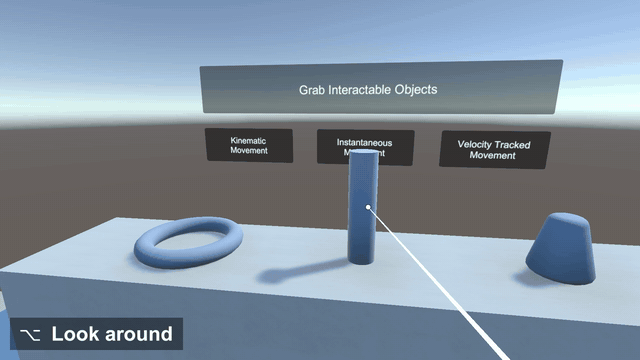
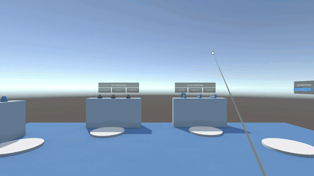
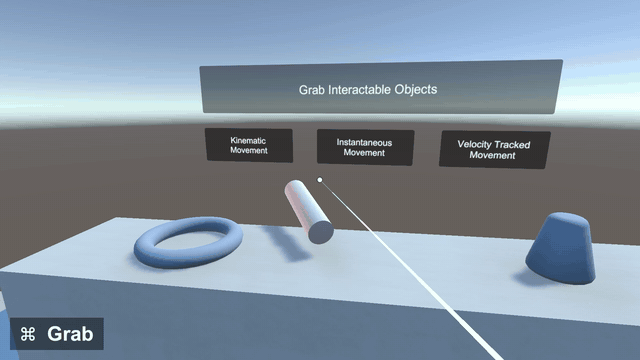

# Simple XR Device Simulator

Test an XR Interaction Toolkit scene in the Unity Editor with a mouse or trackpad and a keyboard.



| Look around and teleport                                                                       | Scale what you're holding                                          |
| ---------------------------------------------------------------------------------------------- | ------------------------------------------------------------------ |
|  |  |

Built for quick checks while developing XR apps. You don't always have a headset with you, and putting one on and off for every small change is slow. Unity's XR Device Simulator can test everything a headset does, but for a simple XR app that's more than you need. This package gives you the controls you use most, on keys that are easy to reach.

Press Play and the mouse becomes your controller. You can look around, click buttons, grab, rotate, scale and teleport.

It works with the XR Interaction Toolkit interactables and UI already in your scene. They respond the same way they do to a real controller, so you can test them as they are.

## Install

In Unity, open **Window > Package Manager**, click **+**, choose **Add package from git URL**, and paste this link:

```
https://github.com/aje0827/Simple-XR-Device-Simulator.git?path=Assets/SimpleXRDeviceSimulator
```

Use this exact link. The page address from your browser won't install.

To stay on one version, add its tag to the end of the link, like `#v3.0.1`. What changed in each version is in the [changelog](Assets/SimpleXRDeviceSimulator/CHANGELOG.md).

If Unity asks to enable the Input System's backends and restart, click Yes. The package reads the mouse and keyboard through it.

**Try it:** click **Tools > Simple XR Device Simulator > Open Test Scene** and press Play. The controls are listed on a panel in the scene.

**Use it in your scene:** drag `Simple XR Device Simulator.prefab` (under **Packages > Simple XR Device Simulator**) into your scene and press Play. It finds the camera and the event system on its own. It only runs in the Editor, so it has no effect on a headset build.

## What it supports

- Any scene with a camera, even an empty one. You don't need an XR rig to look around, click and grab. Teleporting and snap turning move the rig, so those two need an XR Origin rig in the scene.
- One controller. Actions that take two hands in the headset, like scaling, get a key instead.
- It acts like a real controller. A left click is the trigger and Command is the grip, so if a button or a grab doesn't work in the headset, it won't work here either. If your rig grabs with the trigger, a left click grabs too. When it finds a common setup problem, like UI the controller can't press, it tells you in the Console and the Game view.
- The right controller's A and B buttons, on 1 and 2. Anything bound to the right controller's `primaryButton` or `secondaryButton` works as it is.

## Not supported

- The left controller. The mouse is always the right controller, so the left controller's X and Y buttons have no key.
- Hand tracking and climbing.
- Rigs from outside the XR Interaction Toolkit, like Meta's Interaction SDK.

## Controls

The mouse points the controller. A laser shows where it's pointing, and hover highlights show up as they do in the headset.

| Action      | Keys                                         | Same as in the headset                                                   |
| ----------- | -------------------------------------------- | ------------------------------------------------------------------------ |
| Look around | Hold Option / Alt and move the mouse         | Turning your head                                                        |
| Trigger     | Left click                                   | Trigger: press UI buttons, and use what you're holding                   |
| Grab        | Hold Command / Windows                       | Grip: the object follows the mouse, let go to drop it                    |
| Rotate      | Command / Windows + Control + move the mouse | Turning your wrist. Add Shift to roll                                    |
| Scale       | Command / Windows + scroll                   | Two-handed scale, within the limits set on the object's grab transformer |
| Teleport    | Hold right click, then release               | Thumbstick forward, onto teleport anchors and areas. The arc turns red where you can't land |
| Snap turn   | Left / Right arrow keys                      | Thumbstick left / right                                                  |
| A button    | Hold 1                                       | A on the right controller                                                |
| B button    | Hold 2                                       | B on the right controller                                                |

On a Mac trackpad, a two-finger click is the right click and a two-finger swipe is the scroll. Other trackpads haven't been tested.

Recording a demo? Turn on **Show Input Label** on the prefab. It shows the control in use in the corner of the Game view and draws the cursor and a ring on each click, since Unity's Recorder doesn't capture the real cursor. The GIFs above were made that way, in the XR Interaction Toolkit's demo scene.

## Requirements

- Unity 2022.3 (built with 2022.3.58f1, also tested on 2022.3.62f3)
- A camera in the scene. Teleporting and snap turning also need an XR Origin rig
- The XR Interaction Toolkit 3.x and the Input System. Package Manager installs both with this package if they're missing
- Built and tested on macOS. On Windows, the Windows key takes the place of Command. Windows hasn't been tested yet

## License

MIT. See [LICENSE](LICENSE).